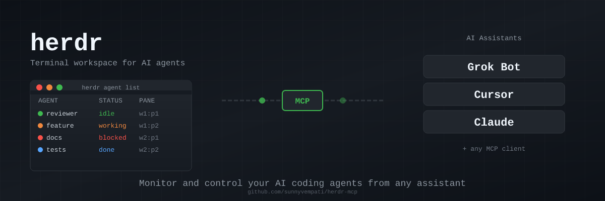

<p align="center">
  
</p>

<p align="center">
  <strong>Monitor and control your AI coding agents from any assistant</strong>
</p>

<p align="center">
  <a href="LICENSE"></a>
  <a href="https://www.npmjs.com/package/herdr-mcp"></a>
  <a href="https://modelcontextprotocol.io"></a>
</p>

---

> **"Which of my agents are blocked?"**
>
> ```
> You: Which of my agents are blocked?
>
> Assistant: Let me check your herdr agents...
>
> ┌──────────┬─────────┬────────┐
> │ AGENT    │ STATUS  │ PANE   │
> ├──────────┼─────────┼────────┤
> │ docs     │ blocked │ w2:p1  │
> │ refactor │ blocked │ w1:p3  │
> └──────────┴─────────┴────────┘
>
> Two agents are blocked. "docs" is waiting on a review
> decision in w2:p1. "refactor" hit a merge conflict in
> w1:p3. Want me to prompt either of them?
> ```

---

## Features

| | |
|---|---|
| 🔍 **Monitor** | List agents, check status (idle/working/blocked/done), read recent output |
| 🚀 **Control** | Start agents, send prompts, manage terminal panes |
| 🔒 **Safe by default** | Read-only tools always on; write tools require explicit opt-in |
| 🌐 **Remote support** | Target agents on remote machines via `--machine` |
| 🤖 **Universal** | Works with Grok Bot, Cursor, Claude, and any MCP client |

---

## Quick Install

### Grok Bot (X plugin marketplace)

Install the **herdr-mcp** plugin from the Grok Bot marketplace. Enable write mode in plugin settings if needed.

### Cursor

Add to your MCP settings (`.cursor/mcp.json`):

```json
{
  "mcpServers": {
    "herdr": {
      "command": "npx",
      "args": ["herdr-mcp"],
      "env": {
        "HERDR_MCP_ALLOW_WRITE": "1"
      }
    }
  }
}
```

### Claude Desktop

Add to your Claude config (`~/Library/Application Support/Claude/claude_desktop_config.json` on macOS):

```json
{
  "mcpServers": {
    "herdr": {
      "command": "npx",
      "args": ["herdr-mcp"],
      "env": {
        "HERDR_MCP_ALLOW_WRITE": "1"
      }
    }
  }
}
```

### Any MCP Client

```bash
npx herdr-mcp
```

Set `HERDR_MCP_ALLOW_WRITE=1` to enable write operations.

---

## Safety Model

**herdr-mcp is read-only by default.** This protects your agents from accidental or unintended modifications.

| Mode | Tools Available | Enable With |
|------|-----------------|-------------|
| **Read-only** (default) | status, list, get, read, wait | Nothing—always on |
| **Read + Write** | All tools | `HERDR_MCP_ALLOW_WRITE=1` |

**No shell passthrough.** Unlike raw terminal access, herdr-mcp never exposes arbitrary shell execution. Every operation goes through herdr's structured CLI.

---

## Tools

### Read-Only Tools (always available)

| Tool | Description |
|------|-------------|
| `herdr_status` | Check if herdr is running and responsive |
| `herdr_workspace_list` | List all terminal workspaces |
| `herdr_tab_list` | List tabs in a workspace |
| `herdr_pane_list` | List panes in a tab |
| `herdr_agent_list` | List all agents with status (idle/working/blocked/done) |
| `herdr_agent_get` | Get details for a specific agent |
| `herdr_agent_read` | Read recent terminal output from an agent's pane |
| `herdr_agent_wait` | Wait for agent state change with timeout |

### Write Tools (require `HERDR_MCP_ALLOW_WRITE=1`)

| Tool | Description |
|------|-------------|
| `herdr_tab_create` | Create a new tab in a workspace |
| `herdr_pane_close` | Close a terminal pane |
| `herdr_agent_start` | Start a new agent in a pane |
| `herdr_agent_prompt` | Send a prompt to a running agent |
| `herdr_agent_send_keys` | Send raw keystrokes to an agent's pane |
| `herdr_agent_rename` | Rename an agent |

---

## Remote Machines

Target agents on remote machines by setting `HERDR_MCP_MACHINE`:

```json
{
  "mcpServers": {
    "herdr-remote": {
      "command": "npx",
      "args": ["herdr-mcp"],
      "env": {
        "HERDR_MCP_MACHINE": "my-server",
        "HERDR_MCP_ALLOW_WRITE": "1"
      }
    }
  }
}
```

This passes `--machine my-server` to all herdr commands, routing operations through SSH to the specified machine.

---

## Usage Patterns

### Monitor-first approach

Always check agent status before taking action:

```
1. herdr_agent_list → see all agents and their states
2. herdr_agent_read → check what an agent has been doing
3. herdr_agent_prompt → only if needed, with human approval
```

### Start-then-prompt recipe

When spinning up a new agent:

```
1. herdr_agent_start → launch agent in specified pane
2. herdr_agent_wait → wait for "idle" state (agent ready for input)
3. herdr_agent_prompt → send initial task
```

### Critical caveat

**The target pane must be at a shell prompt before `agent_start`.** If the pane is running another process, the start command will fail or produce unexpected results.

---

## Development

```bash
# Clone and install
git clone https://github.com/sunnyvempati/herdr-mcp.git
cd herdr-mcp
npm install

# Build
npm run build

# Test
npm test

# Run locally
node build/index.js
```

### Smoke test (requires herdr installed)

```bash
./scripts/smoke.sh
```

---

## Contributing

See [CONTRIBUTING.md](CONTRIBUTING.md) for guidelines.

---

## License

[MIT](LICENSE)

---

<p align="center">
  <sub>
    <em>herdr</em> is a trademark of its respective owner.<br/>
    <em>Grok Bot</em> is a trademark of xAI.<br/>
    <em>Cursor</em> is a trademark of Anysphere, Inc.<br/>
    <em>Claude</em> is a trademark of Anthropic.<br/>
    This project is not affiliated with or endorsed by any of these companies.
  </sub>
</p>
